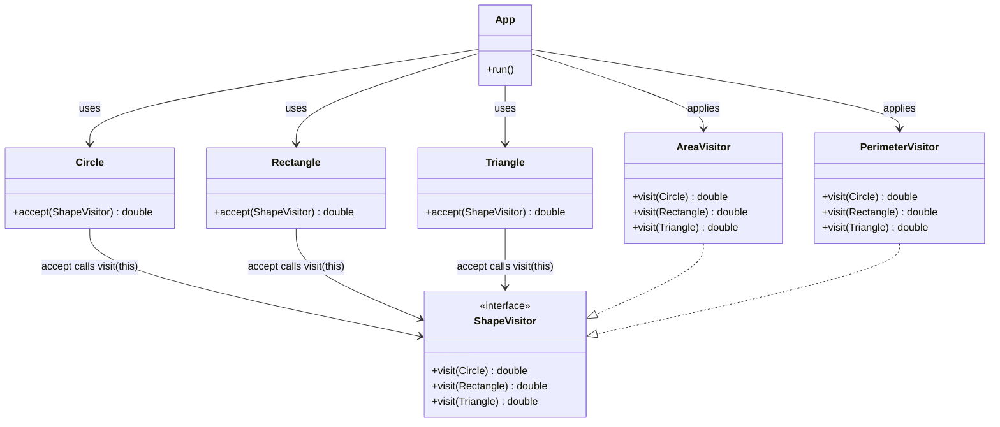

# Visitor Pattern Example

A small Java application demonstrating the Visitor pattern with circles,
rectangles, and triangles. Separate visitors calculate each shape's area and
perimeter, so the operations are kept apart from the shape data.

## Requirements

- JDK 25

The Gradle wrapper is included, and the project is configured to compile with
the Java 25 toolchain.

## Run

From the repository root:

```sh
./gradlew :app:run
```

Run the tests with:

```sh
./gradlew :app:test
```

## How the visitor dispatch works

`App` creates the shapes and passes each visitor to each shape's `accept`
method. The shape calls the matching overloaded `visit` method, which lets the
visitor apply the appropriate calculation for that concrete shape.



`ShapeVisitor` declares one `visit` overload per concrete shape. The concrete
visitors implement those overloads with the formulas for their operation.
Adding another operation can therefore be done with another visitor, while
adding a shape requires adding a corresponding `visit` overload to each
visitor.

The project also has an empty `Shape` marker interface; currently only
`Circle` implements it. The example's visitor dispatch uses the concrete
shapes' `accept` methods.
